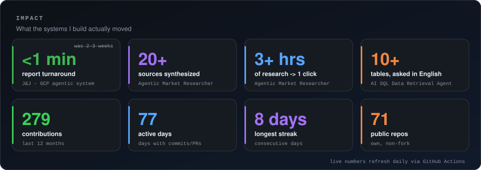

### 👋 Hi, I'm Abhilash

I build **production-grade agentic AI systems on Google Cloud**: LLM-powered apps, RAG pipelines, and the data + MLOps plumbing that keeps them reliable at scale. At **Johnson & Johnson** (via Pozent) I architected a GCP-native agentic system that took medical report generation from **2–3 weeks to under a minute**.

---

### ⚡ Watch an agent system work

This is the shape of what I ship: planner → retrieval → synthesis → validation → human review → delivery, with reviewer feedback looping back into the next draft. Trustworthy AI is a design choice, not an afterthought.

---

### 🤖 Talk to my AI (it's live)

Not a mock-up. Pick a question (or write your own): a GitHub Action runs a fast, low-cost LLM (via OpenRouter) over my real project data and replies on the issue in about a minute. It cites only what's in [`src/data`](src/data) and says so when it doesn't know.

> 🎯 **Hiring?** Paste a job description and the AI returns an *honest* match: evidence **and** gaps. I'd rather earn a conversation than win it with a flattering score.
> _(Requires a free GitHub account. Rate-limited to 5 asks per day per person.)_

---

### 🌌 Skill constellation

### 🧰 Full skill map &nbsp;(click to expand)

Badge brightness = depth: **bright** = shipped in real work · **medium** = used and comfortable · **dim** = exposure.

<!-- SKILLS:START -->

<b>🤖 Agentic & Generative AI</b> &nbsp;·&nbsp; 13 skills, 11 proven in shipped work

 

<b>☁️ Cloud, DevOps & MLOps</b> &nbsp;·&nbsp; 9 skills, 6 proven in shipped work

 

<b>🗄️ Data Platforms</b> &nbsp;·&nbsp; 9 skills, 4 proven in shipped work

 

<b>⚙️ AI Application Backend</b> &nbsp;·&nbsp; 8 skills, 3 proven in shipped work

 

<b>🧪 Machine Learning</b> &nbsp;·&nbsp; 5 skills, 0 proven in shipped work

 

<b>💻 Languages</b> &nbsp;·&nbsp; 6 skills, 2 proven in shipped work

 

<!-- SKILLS:END -->

---

### 🛠️ What I can build for you

<!-- OFFERS:START -->
<table>
<tr><td><b>Agentic AI products</b></td><td>Multi-agent workflows with LangGraph / Google ADK / Claude, tool use and MCP servers, evaluated and human-reviewable.</td></tr>
<tr><td><b>RAG & knowledge systems</b></td><td>Retrieval pipelines on BigQuery / Vertex AI that ground LLMs in your real data.</td></tr>
<tr><td><b>GCP MLOps & deployment</b></td><td>Docker + Kubernetes (GKE), CI/CD, monitoring - from notebook to production.</td></tr>
<tr><td><b>AI backends</b></td><td>FastAPI / Flask services for inference and workflow orchestration.</td></tr>
<tr><td><b>Data pipelines</b></td><td>Dataflow, Pub/Sub, Dataproc and BigQuery pipelines that make data model-ready.</td></tr>
<tr><td><b>Trustworthy AI</b></td><td>HITL review, feedback loops, validation - AI people can sign off on.</td></tr>
</table>
<!-- OFFERS:END -->

---

### 🔗 Let's talk

  
  
  

 

🔧 Every graphic above is generated from [`src/data/profile.json`](src/data/profile.json) and refreshed by GitHub Actions: live contribution data, skills, metrics and the AI's knowledge all come from that one source of truth.
